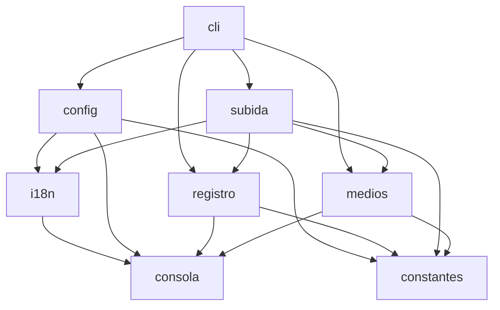
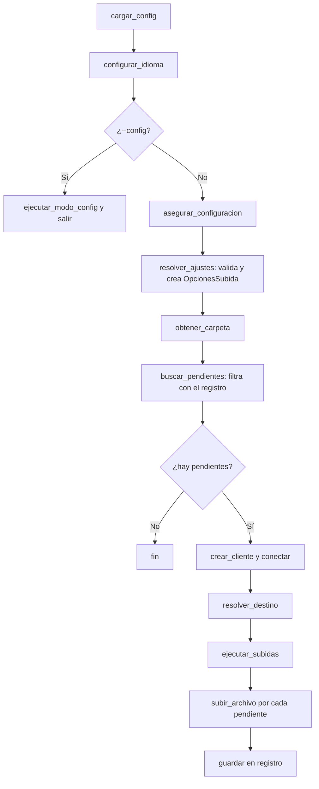

# Arquitectura de Telegram Uploader

> Guía para quien vaya a **modificar o ampliar** el programa, sea una persona o un asistente de IA.
> Para usarlo, ver `README.md`. Para generar un archivo listo para pegar a una IA:
> `python herramientas/contexto.py` (ver la sección 7).

## 1. Qué hace

Sube videos y archivos grandes a un canal privado de Telegram usando la cuenta personal del usuario
(Telethon, no un bot). Sube fragmentos en paralelo, genera miniaturas, ordena por fecha, recuerda lo
ya subido y funciona en español e inglés.

## 2. Estructura

| Archivo | Responsabilidad (una sola) |
|---|---|
| `subir_a_telegram.py` | Lanzador de 15 líneas. Solo llama a `cli.ejecutar()`. |
| `telegram_uploader/constantes.py` | Valores fijos, rutas y `CONFIG_DEFAULTS`. No importa nada del paquete. |
| `telegram_uploader/consola.py` | `console` (rich) y `log`. No importa nada del paquete. |
| `telegram_uploader/i18n.py` | Textos `STRINGS` (es/en), clase `Traductor`, función `t()`. |
| `telegram_uploader/config.py` | Leer/guardar `config.json`, asistente, menú `--config`, enmascarar secretos. |
| `telegram_uploader/registro.py` | `subidos.json` (evita duplicados) y `clave_archivo()`. |
| `telegram_uploader/medios.py` | Buscar archivos, orden cronológico, ffprobe/ffmpeg, miniaturas. |
| `telegram_uploader/subida.py` | Cliente de Telegram, subida por fragmentos con reanudación entre reintentos, reintentos, barra de progreso. |
| `telegram_uploader/cli.py` | Argumentos, validación y flujo de `main()`. Es el único que conoce a todos. |
| `test/` | Pruebas con `pytest` (cliente de Telegram simulado, nunca se conecta). |
| `herramientas/contexto.py` | Genera el contexto para pegar a una IA. |

**Regla de dependencias:** solo hacia abajo, nunca en círculo.



## 3. Flujo de `main()` (en `cli.py`)



## 4. Conceptos clave

- **`OpcionesSubida`** (`subida.py`): ajustes que no cambian entre archivos (números e interruptores:
  `borrar_local`, `dry_run`, pausas, fragmentos, archivos simultáneos).
  *Si es un número o un interruptor, va aquí.*
- **`ContextoSubida`** (`subida.py`): recursos vivos compartidos (cliente, destino, semáforo, barra de progreso).
  *Si es un objeto que "hace cosas", va aquí.*
- **`EstadoSubida`** (`subida.py`): avance de la subida por fragmentos de un archivo (`file_id` y fragmentos completados). Se crea una vez por archivo y se reutiliza entre reintentos, de modo que solo se reenvían los fragmentos que faltan.
- **`Traductor` / `t(clave, **valores)`**: devuelve el texto en el idioma activo. El idioma se fija en
  `cli.configurar_idioma`. No hay variable global de idioma.
- **Datos del usuario** (`config.json`, `sesion_telegram.session`, `subidos.json`) viven junto a
  `subir_a_telegram.py` (`DIRECTORIO_BASE`), nunca dentro del paquete.

## 5. Reglas que NO se pueden romper (invariantes)

1. **`--borrar-local` solo borra tras una subida confirmada.** En `subir_archivo`, el `return False` por
   fallo ocurre antes de `ruta.unlink()`.
2. **`clave_archivo(ruta)` se calcula ANTES de subir** (en `ejecutar_subidas`), porque con `--borrar-local`
   el archivo ya no existirá después.
3. **Nunca poner credenciales en el código, los logs ni el repositorio.** `config.json` y `*.session`
   están en `.gitignore`. `api_hash` se muestra siempre con `enmascarar()`.
4. **Configuración y registro se escriben de forma atómica** (archivo `.tmp` + `os.replace`).
5. **Todo texto visible al usuario va en `STRINGS` con la misma clave en `es` y en `en`.**
   Una prueba comprueba que ambos idiomas tengan las mismas claves.
6. **Dependencias solo hacia abajo.** `constantes` y `consola` no importan nada del paquete.
7. **No usar funciones privadas de Telethon** (las que empiezan con `_`): pueden romperse al actualizar.
8. **No `except Exception: pass`.** Capturar excepciones concretas. La única excepción general está en
   `subir_archivo` y lleva un `# noqa` con su justificación.
9. **Reanudar no cambia lo que se envía.** El `file_id` solo se reutiliza mientras el archivo tenga el mismo número de fragmentos; si Telegram ya no conserva alguno, la subida se reinicia desde cero con un identificador nuevo.

## 6. Recetas: cómo agregar algo tocando lo mínimo

| Quiero agregar... | Tocar |
|---|---|
| Una **opción de línea de comandos** | `cli.py` (`construir_parser` y, si hace falta, `resolver_ajustes`), `i18n.py` (texto de ayuda en es y en), `constantes.py` si tiene valor por defecto |
| Un **ajuste guardado en la configuración** | `constantes.py` (`CONFIG_DEFAULTS`), `config.py` (asistente y menú), `i18n.py` (etiquetas), `cli.resolver_ajustes` (usarlo) |
| Un **cambio en cómo se sube** un archivo | `subida.py`; si es un ajuste nuevo, un campo en `OpcionesSubida` |
| Un **criterio de filtro u orden** nuevo | `medios.py` y `cli.buscar_pendientes` |
| Un **mensaje o idioma** nuevo | `i18n.py` |
| Algo que se **recuerde entre ejecuciones** | `registro.py` |

Después de cualquier cambio:

```bash
python -m pytest -q                       # todas las pruebas deben pasar
ruff check telegram_uploader subir_a_telegram.py herramientas
```

Si agregas comportamiento nuevo, agrega también su prueba en `test/`.

## 7. Cómo pedirle un cambio a una IA

Genera el contexto y pégalo completo:

```bash
python herramientas/contexto.py                          # todo el proyecto (unos 15 mil tokens)
python herramientas/contexto.py --modulos subida         # solo subida y lo que necesita
python herramientas/contexto.py --mapa                   # solo la guía y el mapa
python herramientas/contexto.py --modulos cli --con-pruebas
```

Plantilla sugerida:

> Te paso el contexto de mi proyecto (guía, mapa y código). Quiero: **[describe el cambio]**.
> Respeta las reglas de la sección 5. Dime qué archivos cambias, dame el código completo de cada función
> modificada y escribe las pruebas nuevas. No cambies nada que no esté relacionado con esto.

Luego: copia los cambios, ejecuta `pytest` y `ruff`, y revisa el resultado antes de aceptarlo.

## 8. Limitaciones conocidas (trabajo futuro)

- Las llamadas a `ffmpeg` (atributos y miniaturas de video) son síncronas y detienen el bucle asíncrono mientras se ejecutan. Las operaciones de archivo (tamaño, lectura de fragmentos y borrado local) ya se ejecutan en hilos con `asyncio.to_thread`.
- `ruff` corre en la integración continua y bloquea la fusión si hay hallazgos.
- Las subidas solo se reanudan dentro de la misma ejecución. Si se cierra el programa, el archivo se sube desde cero: Telegram conserva los fragmentos subidos solo entre varios minutos y varias horas, por lo que reanudar entre ejecuciones únicamente serviría si se retoma pronto.
